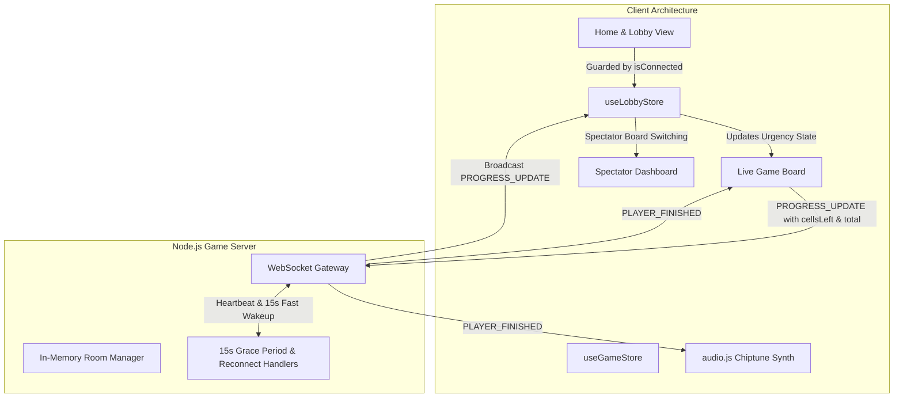

# Multiplayer & System UX Enhancement — Implementation Plan (Updated)

This document outlines the detailed architecture, component modifications, WebSocket protocol updates, and phased rollout for the proposed enhancements to Sudoku-Online, revised with user feedback.

---

## 1. Executive Summary & Scope (Revised)

1. **Backend Connectivity & Offline Protection:** Clearly distinguish between offline-ready Solo mode and server-dependent modes (Co-op, Ranked Race, Friends, ELO). Display graceful connecting skeletons and cold-start indicators.
2. **Room Code & Invite Sharing UX:** Dual-action sharing — clean 6-digit code copying alongside a 1-click invite link (`/?room=123456`) and native Web Share integration on mobile.
3. **Spectator Mode Redesign:** Support multi-player switching (3+ racers), unified single-board view for Co-op rooms, and a complete post-game podium and rematch loop for spectators.
4. **Sensible & Fun Quick Presets / Chat:**
   - **Lobby Presets & Chat:** Pre-game banter, readiness, and game style proposals.
   - **In-Game Quick Emotes & Presets:** Mode-specific (Race vs Co-op) presets.
   - **Zero Grid Interference Guarantee:** On mobile devices, emote buttons and triggers live strictly in the header/toolbar; floating particles or toasts never occlude the 9x9 board or keypad.
5. **Network Resilience & Disconnection Protection:** Fast page visibility/unlock auto-reconnect, **15-second fair-play auto-pause & grace period**, and non-destructive reconnecting overlays.
6. **Live Progress Clarity & End-Game Urgency:** Display both percentage and cells remaining in the exact format: **`84% • 5/32 cells left`**, with dynamic color scaling and peripheral warning auras as opponents near completion.
7. **Single Non-Stacking Finish Ticker (4+ Player Friendly):** Replaces stacking banners with a compact, fixed-height **Leaderboard Ticker Ribbon** at the top of the board and status badges on opponent cards, keeping the board 100% visible for remaining solvers.

---

## 2. Architecture & Data Flow



---

## 3. Detailed Component & Protocol Specifications

### 3.1 Backend Connectivity & Offline Guarding

- **Connection States:**
  - `connected` (Emerald): Fully operational.
  - `connecting` (Amber with pulse spinner): Cold-start / reconnection in progress.
  - `offline` (Slate/Red): Unreachable after max retries.
- **UI Guarding in `App.jsx`:**
  - **Solo Mode:** Always enabled, badged with `"Instant Play • Offline Ready"`.
  - **Multiplayer / Co-op Cards:** When `connectionState === 'connecting'`, display a frosted loading overlay:
    > *"Connecting to multiplayer server (free cloud spin-up takes ~20–30s on first load)..."*
    Buttons show an animated spinner instead of dead clicks.
  - **Header ELO Badge:** Replaces raw `"Offline"` with an amber pulsing pill `"Connecting to server..."`.

---

### 3.2 Room Code vs 1-Click Link Sharing

- **Dual-Action Lobby Bar:**
  1. **Code Snippet:** Displays `123456` with a small copy icon that copies **strictly the raw digits**.
  2. **1-Click Share Button:**
     - **Desktop:** `[ 🔗 Copy Invite Link ]` (copies `https://sudoku.app/?room=123456` and flashes a green checkmark).
     - **Mobile:** `[ ↗️ Share Room ]` (triggers `navigator.share({ title: 'Sudoku Room', text: 'Join my Sudoku room!', url: getJoinUrl() })`).

---

### 3.3 Quick Presets & Social Communication

#### Mobile Screen Protection (Zero Grid Interference Guarantee):
On mobile screens, every square millimeter of the 9x9 grid and keypad is essential.
- **Trigger Location:** Placed in the **header/toolbar** (beside Theme / Settings / Volume), completely separated from the board.
- **Display Location:** Incoming reactions and messages render inside the **Opponent Header Card** or top status strip, never floating across or blurring the numbers on the board.

#### Sensible & Fun Presets Catalog:

```markdown
### Pre-Game Lobby Presets
• "Ready when you are! 🚀"
• "Warm up that brain! 🧠"
• "No hints challenge? 😏"
• "One warm-up match first! ☕"
• "Good luck, have fun! 🤝"
• "Take your time, no rush! ⏳"
• "Rematch is on! 🔥"

### In-Game Competitive Race Presets
• "Found the bottleneck! 💡"
• "So close! ⚡"
• "Brain melting... 🫠"
• "Nice speed! 👏"
• "Wait, which row was that?! 😱"
• "GG! 🏁"

### In-Game Co-op Presets (Tactical & Helpful)
• "Check Box 5 📦"
• "I'll do the corners! 📐"
• "Stuck on row 7 🔍"
• "Nice placement! 👍"
• "Double check col 3! ⚠️"
• "Great teamwork! 🤝"
```

---

### 3.4 15-Second Grace Period & Disconnect Auto-Pause

#### Config & Rules:
- **15-Second Grace Timer:**
  - If Player A disconnects, the server sets `reconnectBy = Date.now() + 15000`.
- **Auto-Pause (Friendly 1v1 & Co-op):**
  - Timer pauses instantly for up to **15 seconds** with an on-screen status banner:
    `"Player A disconnected. Pausing game for 15s while they reconnect..."`.
  - Once Player A reconnects, a brief 3-second resume countdown (`3... 2... 1... Go!`) allows both players to get their hands back in position.
- **Fast Tab / Screen Wakeup:**
  - Listens to `document.addEventListener('visibilitychange')` and `window.addEventListener('online')` to trigger instantaneous WebSocket re-attachment without waiting for backoff timers.

---

### 3.5 Live Progress (`5/32 cells left`) & End-Game Urgency

#### WebSocket Protocol Update:
```json
{
  "type": "PROGRESS_UPDATE",
  "payload": {
    "progress": 84,
    "strikes": 1,
    "filled": 27,
    "total": 32,
    "cellsLeft": 5
  }
}
```

#### Visual Escalation System:
1. **Opponent Progress Display:**
   - Exact format: **`Alex: 84% • 5/32 cells left`**.
2. **Progress Bar Color Stages:**
   - `0% – 59%`: Primary Theme Accent (Cyan / Emerald).
   - `60% – 84%`: Amber Warning (`#f59e0b`).
   - `85% – 100%`: Hot Orange/Crimson (`#ef4444`) with an accelerated pulsing glow (`animate-pulse`).
3. **Climax Perimeter Aura:**
   - When any opponent has **$\le 5$ cells remaining**:
     - Status badge: `⚠️ Opponent has 5/32 cells left!`.
     - Subtle non-intrusive peripheral vignette glow around the board frame to heighten excitement without blocking numbers.

---

### 3.6 Multi-Player Finish Alerts (Non-Stacking Ticker Ribbon)

#### Addressing 4-Player Competition:
If 4 players race, stacking individual modal banners covers the screen and frustrates remaining solvers.

#### The Single-Ribbon Solution:
Instead of stacking banners, use a **Single Fixed-Height Leaderboard Ribbon** docked cleanly above the board:
- **When 1st Player Finishes:**  
  Ribbon displays:  
  `🥇 Alex finished in 03:42! (3 spots left)`
- **When 2nd Player Finishes:**  
  Ribbon updates in-place:  
  `🥇 Alex (03:42) • 🥈 Jordan (04:15) — 2 spots left! Keep solving!`
- **Opponent Cards:**  
  The opponent's individual progress bar cleanly switches to a permanent medal pill:  
  `[ 🥇 03:42 ]` or `[ 🥈 04:15 ]`.
- **Audio Cue:**  
  A single quick, crisp chiptune finish chime triggers once per placement without interrupting gameplay.
- **Zero Screen Obstruction:** The Sudoku grid remains 100% visible and responsive at all times.

---

### 3.7 Enhanced Spectator System

1. **Co-op Spectating:** Single centered board showing live partner pointers (`👉 Jordan`), shared placements, and real-time cursor highlights.
2. **Competitive Race Spectating (Up to 8 players):**
   - **Desktop:** Multi-board grid or Focus Board + racer thumbnails.
   - **Mobile:** Top horizontal player switcher tabs (`[ 👁️ Alex (5/32 left) ] [ 👁️ Jordan (12/32 left) ]`).
3. **Post-Game Flow:**
   - Spectators see the full podium summary at the end.
   - If players vote to rematch, spectators follow into the next round automatically.

---

## 4. Phased Implementation Roadmap

| Phase | Scope | Deliverables |
| :--- | :--- | :--- |
| **Phase 1** | **Connection Guarding & Room Sharing** | Server status indicators (Connecting/Online), disabled states with friendly cold-start notices, dual-action Room Code copying vs 1-Click Link (`/?room=`) + Web Share. |
| **Phase 2** | **Live Progress & Dynamic Urgency** | `cellsLeft` tracking (`84% • 5/32 cells left`), dynamic progress bar color stages, peripheral urgency aura. |
| **Phase 3** | **Finish Alerts & 15s Resilience** | Single non-stacking Leaderboard Ticker Ribbon for 2–4+ player races, chiptune finish alert, 15s disconnect grace period, auto-pause on disconnect, and instant tab wakeup. |
| **Phase 4** | **Spectator Suite** | Single-board Co-op spectator view, multi-racer carousel for competitive spectator mode, spectator game-over podium & rematch follow. |
| **Phase 5** | **Preset Reactions & Chat** | Header-anchored quick-reaction preset menu (lobby & in-game), zero grid interference on mobile, optional spectator/lobby text drawer. |

---

## 5. Verification Plan

1. **Unit & Protocol Tests (`server/test/multiplayer.test.js`):**
   - Test 15-second grace period expiration and auto-pause synchronization.
   - Test `PROGRESS_UPDATE` with `cellsLeft` and `total`.
   - Test multi-player finish notifications (1st, 2nd, 3rd) and non-stacking state.
2. **Mobile Layout Checks:**
   - Test on small viewports (< 375px width) to guarantee 0% grid obstruction from presets, headers, or finish tickers.
3. **Build & Performance:**
   - Verify `npm test` (all tests passing) and `npm run build` with PWA compliance.
